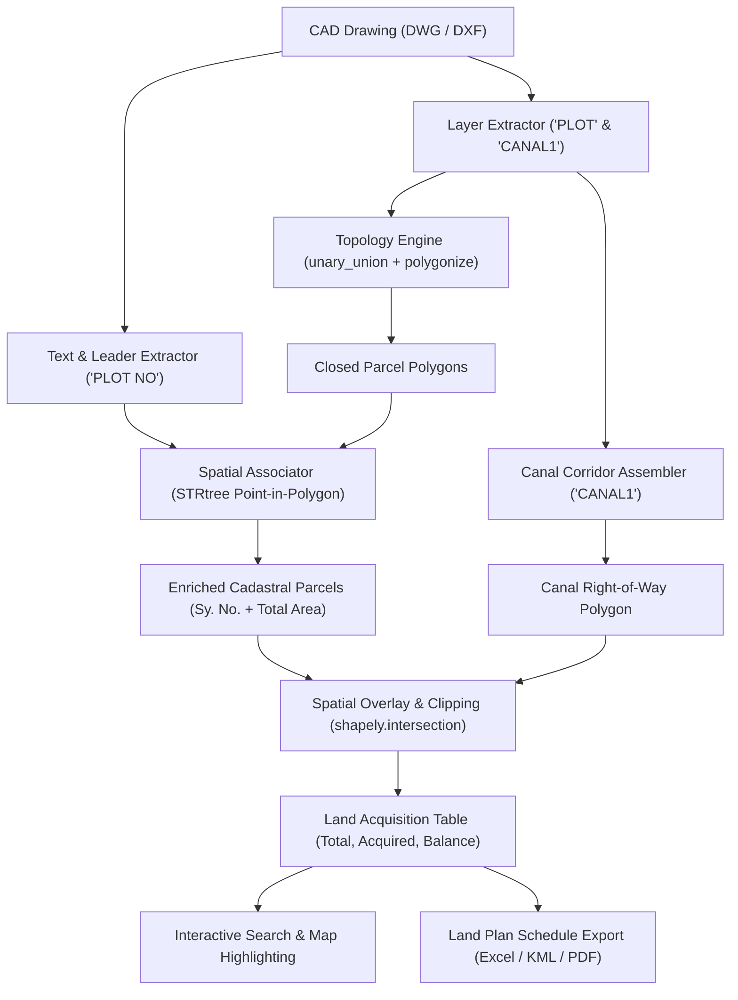

# Cadastral Village Survey & Canal Land Acquisition Engine
## Technical Specification & Implementation Blueprint

---

## 1. Executive Summary

In infrastructure projects (such as irrigation canals, highways, railways, and pipelines), calculating **Land Acquisition (Right-of-Way / RoW)** is historically a tedious, error-prone manual task for surveyors and revenue officials. Surveyors manually inspect village revenue maps, identify which agricultural survey numbers (sub-divisions) intersect the project alignment, and measure:
1. **Total Extent of the Survey Number** (Gross land area owned).
2. **Acquired Extent** (The portion taken by the canal alignment corridor).
3. **Balance Extent** (The remaining unacquired land left to the farmer/landowner).

This specification details how to transform CAD drawings (such as the verified **HNSS Main Canal** drawings in the `sample/` directory) into an **automated spatial analysis pipeline** with an interactive **GIS Cadastral Workstation**.

---

## 2. Ground Truth Analysis from Sample Datasets

Inspecting `sample/1) KONAMPALLE...dwg`, `sample/2) PADAMATIYALERU...dwg`, and `sample/1.Phase 2 -Co-ordinates.xlsx` reveals the exact CAD structuring:

### 2.1 Project Metadata
- **Project**: HNSS (Handri-Neeva Sujala Sravanthi) Main Canal Phase-II.
- **Client**: Water Resources Department, Government of Andhra Pradesh.
- **Location**: Village No. 49 Konampalle & Village No. 50 Padamatiyaleru, Beluguppa Mandal, Anantapuramu District.
- **Coordinate Reference System (CRS)**: UTM Zone 44N (`EPSG:32644`) in meters.

### 2.2 CAD Layer Schema
| CAD Layer | Entity Types | Semantic Role |
| :--- | :--- | :--- |
| `VILLAGE BOUNDRY` | `LWPOLYLINE` | Outer territorial administrative boundary of the revenue village. |
| `VILLAGE STONES` | `LWPOLYLINE`, `MTEXT` | Boundary pillars / survey tri-junction stones connecting neighboring villages. |
| `PLOT` | `LWPOLYLINE`, `ARC` | Parcel boundary lines dividing agricultural survey numbers. |
| `PLOT NO` | `TEXT`, `MTEXT`, `LEADER` | Unique parcel identifiers (Survey Numbers: 1, 2, 3... 216) + pointer lines for narrow plots. |
| `CANAL1` | `LWPOLYLINE`, `HATCH` | Canal engineering alignment: Centerline, Bed Width, Top Width, and Land Acquisition Boundary (RoW). |
| `STRUCTURE` | `MTEXT`, `LWPOLYLINE`, `INSERT` | Hydraulic structures (Regulators, Aqueducts, Under Tunnels, Bridges) with chainages. |
| `CSMark` / `CH` | `TEXT`, `POINT`, `HATCH` | Chainage milestones at 100m intervals along the canal center. |

---

## 3. Mathematical & Geospatial Core



### 3.1 Topology Reconstruction (Polygonization)
In CAD survey drawings, parcels are drawn as separate line segments (`LWPOLYLINE` / `LINE`). They must be converted into planar topological polygons:
1. Extract line coordinates from layers `PLOT` and `VILLAGE BOUNDRY`.
2. Compute `shapely.ops.unary_union(lines)` to node all intersections and snap vertices within tolerance $\epsilon = 0.05\text{ m}$.
3. Generate closed polygons via `shapely.ops.polygonize()`.
4. Filter out slivers and sheet framing rectangles ($\text{Area} > 50\text{ m}^2$).

### 3.2 Survey Number Association (Point-in-Polygon & Leader Tracing)
Every text label on layer `PLOT NO` represents a survey number:
- **Primary Match**: Test if the text insertion point $P(x, y)$ is strictly within parcel polygon $Q$:
  $$P \in Q \iff \text{contains}(Q, P)$$
  Indexed via `shapely.STRtree` for sub-millisecond lookups.
- **Secondary Match (Leader Lines)**: In dense or elongated plots, surveyors place the text outside and draw a `LEADER` line pointing into the plot. The engine extracts the leader's endpoint coordinate $P_{\text{tip}}$ and assigns the survey number to the polygon containing $P_{\text{tip}}$.

### 3.3 Land Acquisition Intersection Equations
Given survey parcel polygon $P_i$ and canal right-of-way corridor polygon $C$:

$$\text{Acquired Geometry } G_{\text{acq}} = P_i \cap C$$
$$\text{Balance Geometry } G_{\text{bal}} = P_i \setminus C$$

$$\text{Total Area } A_{\text{total}} = \text{Area}(P_i)$$
$$\text{Acquired Area } A_{\text{acquired}} = \text{Area}(G_{\text{acq}})$$
$$\text{Balance Area } A_{\text{balance}} = A_{\text{total}} - A_{\text{acquired}}$$
$$\text{Acquisition Percentage } \%_{\text{acq}} = \left( \frac{A_{\text{acquired}}}{A_{\text{total}}} \right) \times 100\%$$

### 3.4 Revenue Unit Conversions (Indian Standard)
Survey areas are converted into standard Indian revenue notation:
$$\text{Acres} = \frac{\text{Area in m}^2}{4046.8564224}$$
$$\text{Whole Acres} = \lfloor\text{Acres}\rfloor$$
$$\text{Cents} = (\text{Acres} - \text{Whole Acres}) \times 100$$
$$\text{Guntas (if applicable)} = (\text{Acres} - \text{Whole Acres}) \times 40$$

> [!NOTE]
> **Example from live test on Konampalle drawing (Survey No. 113)**:
> - $\text{Total Area} = 623,539\text{ m}^2 \rightarrow \mathbf{154.08\text{ Acres}} \text{ (154 Ac 8 Cts)}$
> - $\text{Canal Acquired Area} = 1,672\text{ m}^2 \rightarrow \mathbf{0.41\text{ Acres}} \text{ (41.3 Cents)}$
> - $\text{Balance Area} = 621,867\text{ m}^2 \rightarrow \mathbf{153.67\text{ Acres}} \text{ (153 Ac 67 Cts)}$

---

## 4. Workstation Architecture & User Experience

```
┌─────────────────────────────────────────────────────────────────────────────┐
│ 🔍 Search Survey No. [ 113                     ] 📍 Konampalle Village      │
├───────────────────────────────────┬─────────────────────────────────────────┤
│  CADASTRAL LAND PARCEL HUD        │           LEAFLET SATELLITE MAP         │
│  Survey Number : 113              │                                         │
│  Village       : Konampalle       │          ┌───────────────────────┐      │
│  Mandal        : Beluguppa        │          │  Survey No. 113       │      │
│ ───────────────────────────────── │          │  (Balance Land)       │      │
│  Total Extent  : 154.08 Acres     │          │  [Light Green Fill]   │      │
│                  (623,539 m²)     │          │                       │      │
│  Canal Acquired: 0.41 Acres       │          │  ░░░░░░░░░░░░░░░░░░░  │      │
│                  (1,672 m² / 41c) │          │  Canal RoW (Acquired) │      │
│  Balance Land  : 153.67 Acres     │          │  [Hatched Red Fill]   │      │
│                  (621,867 m²)     │          │  ░░░░░░░░░░░░░░░░░░░  │      │
│  Chainage Cut  : KM 216.5-216.7   │          └───────────────────────┘      │
│ ───────────────────────────────── │                                         │
│  [📥 Export Form A (Excel)]       │                                         │
│  [📄 Print A4 Survey Sketch]      │                                         │
└───────────────────────────────────┴─────────────────────────────────────────┘
```

### 4.1 Search & Fly-To Experience
- A dedicated **Cadastral Search Bar** appears in the workstation header.
- Typing any number (e.g. `113` or `45/2`) displays auto-suggestions with village name and total acreage.
- Selecting a match animates the camera directly to the parcel with smooth bounds padding (`map.flyToBounds(parcelBounds)`).

### 4.2 Tri-Color Visual Highlighting
When a parcel is selected:
1. **Yellow Outline**: The complete legal boundary of the survey number.
2. **Hatched Red Area**: The exact strip of land acquired by the canal corridor.
3. **Translucent Blue/Green Area**: The untouched balance land retained by the farmer.

### 4.3 Land Plan Schedule (LPS / Form A) Export
Generates the statutory Land Acquisition requisition spreadsheet required by Government Revenue Departments:

| Sl. No. | Village | Mandal | Survey No. | Total Extent (Ac-Cts) | Acquired Extent (Ac-Cts) | Balance Extent (Ac-Cts) | Chainage From - To |
| :---: | :---: | :---: | :---: | :---: | :---: | :---: | :---: |
| 1 | Konampalle | Beluguppa | 105 | 8 Ac 23 Cts | 0 Ac 00 Cts | 8 Ac 23 Cts | Non-acquired |
| 2 | Konampalle | Beluguppa | 112 | 31 Ac 54 Cts | 0 Ac 00 Cts | 31 Ac 54 Cts | Non-acquired |
| 3 | Konampalle | Beluguppa | 113 | 154 Ac 08 Cts | 0 Ac 41 Cts | 153 Ac 67 Cts | KM 216.500 to 216.700 |

---

## 5. Technical Implementation Roadmap

### Phase 1: Backend Extraction Engine (`dxf2kml/cadastral.py`)
- Add `CadastralEngine` class with `extract_parcels()` and `intersect_canal()`.
- Add endpoint `POST /api/cadastral/analyze`:
  - Uploads DWG/DXF.
  - Automatically identifies parcel and canal layers.
  - Returns GeoJSON with embedded survey parcel properties (`survey_number`, `total_area_m2`, `total_acres`, `acquired_area_m2`, `acquired_acres`, `balance_acres`).

### Phase 2: Next.js Cadastral Workstation Mode (`frontend/`)
- Add a top-level workspace toggle: `[Standard Converter] | [Cadastral & Land Acquisition]`.
- Implement `CadastralSearchBar.tsx` with fuzzy search over survey numbers.
- Implement `LandAcquisitionCard.tsx` displaying the acquired vs balance breakdown.
- Layer rendering with dual polygons (Balance geometry vs Acquired geometry).

### Phase 3: Reporting & Compliance Exports
- **Excel Requisition Sheet**: Generated on-the-fly with `openpyxl`.
- **Google Earth KML**: Generates KML with customized balloons detailing land acquisition information.
- **A4 Land Sketch PDF**: Generates high-DPI survey sketch prints showing North Arrow, Village Title, and Acquisition dimensions.
